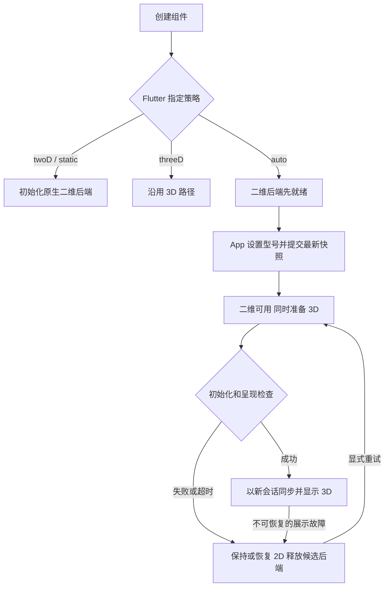

# Flutter 智能床展示降级方案与改造清单

日期：2026-09-22。状态：**已批准实施的设计基线**。实际接口及范围以 [RENDER_FALLBACK.md](RENDER_FALLBACK.md) 和源码为准，验证结果见 [VALIDATION.md](../VALIDATION.md)。下文保留方案阶段的建议与改造前事实；Dart 中 `static` 为保留字，正式枚举使用 `staticImage`。

本方案依据当前仓库源码编写。已确认的产品方向是：不以电视品牌或型号清单作为前提；由 Flutter App 决定使用 3D 或降级展示；降级展示保留床垫外观，以光效表达调节。本文的接口名称、模块划分和时间参数是建议实现，不表示当前版本已经提供。

## 1. 推荐方案与范围

采用同一 Flutter 组件内的两种展示后端：现有 WebView 3D 后端，以及新增的 Flutter 原生 2D 后端。2D 后端提供动态光效和静态标记两种模式。

| 模式 | 展示 | 对 WebView 的依赖 |
| --- | --- | --- |
| `threeD` | 现有模型、几何形变、扫描、热纹、按摩、镜头 | 需要成功创建 WebView、执行模型脚本、创建 WebGL 2 |
| `twoD` | 离线预渲染床垫图片、分区扫描、充放气光圈、热纹、按摩波纹 | 无；不创建 WebView |
| `static` | 同一图片、区域常亮、状态文字、角度示意 | 无；不运行持续动画 |

在自动选择期间允许短时间初始化 3D 候选后端；一旦选择 2D，失败的 WebView 必须退出组件树并释放可释放资源。纯 2D 和静态策略从启动开始都不创建 WebView。

首版覆盖现有内置 `t11-plus`、`t12`、`generic`。继续保留原 3D 的全部结构、材质、配色及工作台功能。2D 首版使用每个内置型号的正式预设外观，任意材质编辑、结构拆解和任意镜头不纳入二维复刻范围，能力接口必须对此明确说明。

本方案面向可以运行当前 Flutter Android/iOS App 的终端。它解除降级画面对 WebView 版本和 WebGL 的依赖，不自动扩展为电视厂商所有操作系统的 Flutter 移植。纯网页的旧浏览器降级包不纳入首版；如未来需要，可复用静态资源与区域元数据另行实现。

## 2. 当前代码事实与改造原因

| 已核对的现状 | 证据 | 对方案的影响 |
| --- | --- | --- |
| 离线 3D 构建目标为 Chromium 111 / Safari 16.4 | [vite.embed.config.js](../vite.embed.config.js) | 旧内核可能在执行初始化检测之前就无法解析脚本 |
| 入口要求 WebGL 2、ResizeObserver、structuredClone | [src/embed-app.js](../src/embed-app.js) | 不能仅在 Three.js 内部增加 try/catch 解决降级 |
| View 在 initState 立即构造 WebViewController | [view.dart](../flutter/smart_mattress_viewer/lib/src/view.dart) | 2D 路径必须把 WebView 创建改为按需，并覆盖构造阶段异常 |
| ready、调用分发和 Session 都与 WebView instanceId/modelToken 绑定 | [controller.dart](../flutter/smart_mattress_viewer/lib/src/controller.dart) | 需要抽象后端，同时保留固定会话与旧调用拒绝规则 |
| 出错时显示错误及重新加载按钮 | [view.dart](../flutter/smart_mattress_viewer/lib/src/view.dart) | 目前没有可接收状态的替代画面 |
| model.presented 仅表示某型号首帧已提交 | [mattress-sdk.js](../src/mattress-sdk.js) | 不足以证明最新快照已进入待切换的首帧，需要补充状态关联的呈现屏障 |
| 区域定义、范围校验、快照/增量与断序规则主要在 JS | [device-state.js](../src/device-state.js)、[model-profiles.js](../src/model-profiles.js) | Flutter 2D 需要等价的状态处理；不能只画最后收到的一条消息 |
| 打包脚本只生成 HTML 和 manifest | [package-flutter.mjs](../scripts/package-flutter.mjs) | 必须加入静态资源、型号元数据及配套文档同步 |

当前 Three.js 渲染器只支持 WebGL 2，WebGL 1 已不再支持。因此保留现有 3D，再提供独立的二维后端，比引入一条旧版 Three.js 维护分支更符合本任务。[Three.js 官方说明](https://threejs.org/docs/pages/WebGLRenderer.html)

## 3. Flutter 选择策略

将“选择哪个展示后端”与现有 `PerformanceMode` 分开。`PerformanceMode.auto → native` 的原画质规则保持不变。

拟新增：

```dart
enum RenderPolicy { auto, threeD, twoD, static }
enum RenderMode { threeD, twoD, static }
```

| 策略 | 行为 |
| --- | --- |
| `auto` | 先提供本地二维画面，再尝试 3D；成功后展示 3D，明确失败或超时后保持 2D |
| `threeD` | 仅使用 3D，失败按原有方式报错；用于保留旧集成行为及排障 |
| `twoD` | 直接使用静态图和光效，不探测或创建 WebView |
| `static` | 直接使用静态图和状态标记，不创建 WebView，不运行持续光效 |

兼容发布时，`MattressView` 新参数默认保持 `threeD`，避免旧 App 升级组件后隐式改变回调次数与行为。新的团队接入示例明确传 `RenderPolicy.auto`；采用哪种策略由 App 决定。此默认值是迁移策略，不意味着正式电视 App 应继续强制 3D。

App 可在运行时修改 Widget 的 renderPolicy。保持单一配置入口，首版不再增加一套与 Widget 属性相互覆盖的 Controller 策略 setter。提供独立的 `retryThreeD()`，仅在 auto 策略下显式触发一次重试。

不使用电视品牌白名单，不根据 Android 系统版本直接判断支持，不根据 UA 单独作成功判断。不自动持久化失败黑名单；本次挂载内最多自动尝试一次 3D，显式重试或新的页面实例才产生新尝试。

## 4. 初始化与切换状态机



### 4.1 自动模式的具体顺序

1. 加载本地型号目录与二维后端。型号尚未选择时显示中性占位；型号选定后显示对应图片，不把通用床垫冒充成特定型号。
2. 原生后端发出 `renderer.ready`，Controller.ready 完成，View 调用 onReady。App 按现有调用方式 setModel、设置腰部映射、提交完整快照并绑定增量。
3. 二维光效已经可用，再开始一次 3D 尝试。若 App 尚未提供型号或初始状态，停留在等待数据状态，不能记成 3D 故障。
4. 按需构造 WebViewController、平台视图和桥接。覆盖构造、平台调用、资源读取和脚本启动各阶段的失败。
5. 3D 候选具备运行条件后，进行一次受控的会话重绑定；该期间二维画面仍保留。新会话加载当前型号、当前映射和最新完整快照，然后接收后续增量。
6. 通过当前 generation、instanceId、modelToken 和状态版本关联的首帧提交检查后，才替换二维画面。
7. 尝试失败则回到二维后端；已经更换过会话时再次建立新的二维会话，通知 App 重绑定。本次自动尝试标记为结束，不能因 onReady 再次执行又启动 3D，形成循环。

因此，auto 模式下一次页面生命周期内 onReady 可能执行多次。它表示“当前后端可建立型号会话”，不等于“3D 成功”或“设备在线”。示例必须取消旧订阅并捕获新的固定 Session。

### 4.2 超时与首帧

- 候选默认：3D 尝试使用一个统一的 **6 秒有效前台预算**，允许 App 配置。这是待测的产品参数，不是兼容性标准或已测性能结论。
- 预算覆盖平台创建、桥接、模型加载和提交有效首帧；内部阶段不能每次都重新获得完整预算。
- 原来的 requestTimeout/loadTimeout 仍用于兼容调用；自动尝试时各阶段等待不得超过剩余尝试预算，不能将 10 秒、30 秒超时依次叠加。
- 页面隐藏、容器为零尺寸或等待 App 提供首份状态时不消耗相应展示等待预算；等待 App 的状态需单独报告 `awaitingState`，不能触发电视不兼容判断。
- 3D 候选必须具有有限、非零的布局尺寸；不要将其 Offstage、设为 0×0 或 setVisible(false) 后等待首帧。可以在静态画面背后短时间准备，但必须验证平台视图合成下实际能够绘制。
- 现有 model.presented 保留原语义。新增可关联状态版本的 `bridge.present` 呈现屏障，详见第 9 节；收到 onPageFinished 或 bridge.ready 都不能直接撤去静态底图。
- 首帧提交是程序可观察的完成条件，不等价于证明每台终端屏幕像素都已正确显示。App 保留强制 twoD 的入口。

### 4.3 运行中故障

| 情况 | 自动策略 |
| --- | --- |
| WebView 创建失败、主页面加载失败、脚本无法启动、明确不支持运行能力 | 转 2D；记录具体阶段和错误码 |
| 3D 预算耗尽、当前快照无法获得首帧提交 | 转 2D，迟到成功不得反向抢占 |
| CONTEXT_LOST | 立即保留/显示二维画面；允许一次有界恢复，建议前台 2 秒；恢复并重同步成功可继续 3D，否则转 2D |
| 已失效/重复的旧回调 | 丢弃，不触发降级或改变新实例 |
| 普通状态调用 REQUEST_TIMEOUT | 结果未知，走重同步/健康检查；一次超时不直接判定硬件不兼容，不自动重放动作 |
| 非法区域、数值越界、未知型号、非法配置 | 业务或资源错误，正常拒绝，不能靠换后端掩盖 |
| PROTOCOL_MISMATCH | 发布配套错误；记录并报告。仅在本地 2D 资源与当前 App 契约校验成功时可保底展示，不能静默当成正常兼容降级 |
| 设备离线、页面隐藏 | 停止相关动画或绘制，不作为 3D 故障 |
| 静止时没有渲染帧 | 正常按需绘制，不设“持续没有帧就故障”的检测 |

首版不根据偶发低帧率自动切后端。后续若增加性能自动降级，需要独立的采样窗口、持续阈值、冷却期和实测依据，不能把 JS CPU 提交耗时当成 GPU 帧率。

## 5. 二维画面与调节效果

### 5.1 资产与坐标

每个内置型号至少交付：一张固定斜俯视底图、区域轮廓数据、效果预制资源和版本描述。底图由开发环境中的现有模型离线导出，不要求旧电视自己截图。

采用一套共享坐标变换：底图使用 contain 缩放，区域轮廓基于底图归一化坐标 `[0,1]`，光效和标签同步执行缩放与留白偏移。固定裁剪规则；禁止底图 cover 裁切而遮罩仍按 contain 定位。记录床面轮廓、左右半侧、气路/调节区、热区、按摩区和标签锚点。

坐标与底图使用同一相机、姿态和版本生成；人工只做可记录的视觉修正。JSON 使用明确的 `left/right`，保持仰躺人体左右。当前源码 humanSide(1) 为 left、humanSide(0) 为 right，不允许二维实现自行假定 0=left。文档中现存相反的数字映射应在实施时更正。

建议首版底图长边约 1600–1920 像素，并按实际模型容器尺寸解码，而不是按整块 4K 屏幕解码。1920×1080 RGBA 单图约占 7.9 MiB，文件压缩大小不能代替解码内存估算。分辨率和包体预算以实际资源导出结果确定。

### 5.2 行为映射

| 状态/动作 | twoD | static |
| --- | --- | --- |
| 首次进入某侧软硬调节 | 青蓝扫描经过该侧床面，再强调活动区域 | 活动区域常亮 |
| 同侧连续换部位 | 移动强调，保持该侧已进入状态 | 直接更新高亮区域 |
| inflating / deflating | 光圈分别扩散/收拢，并显示充气中/放气中 | 状态文字与方向图标 |
| adjusting | 中性呼吸光；不从压力升降推测真实硬件动作 | 调节中标记 |
| idle | 停止动态光效，状态值仍可查看 | 保持状态文字 |
| heating | 橙红热纹，强度按展示档位区分 | 热区常亮和档位 |
| holding | 稳定暖色，区别于升温流动 | 保温标记 |
| massage running | 对应侧紫色波纹，按传入强度和周期播放 | 按摩中、强度标记 |
| massage paused | 冻结/转静态高亮，标明暂停 | 暂停标记 |
| off / fault | 关闭正常工作光效，故障使用图标/文字 | 同左 |
| online=false / 未知字段 | 停止无依据动画；保留最后已知值并标明过期/未知 | 同左 |

光效优先使用简单渐变、预制透明贴图、透明度与位移动画。蓝色轮廓表示软硬，橙色面光表示热区，紫色细波纹表示按摩；支持双侧同时运行，通过形态和文字共同区分状态，不只靠颜色。

静态底图始终保持完整外罩；2D 扫描表示区域调节，不承诺真实内部透视。T12 可按七路的行带轮廓强调，不需要逐一实时绘制 126 个动态囊体。T11+ 仍是每侧肩、腰、臀三路，不能新增腿部软硬区；腿部加热保留。

加热、按摩和支撑按各自配置映射，T12 腰部选择变化只重新组织部位与物理气路的关联，不搬动实际气路、不改写已上报值。

### 5.3 姿态与视觉动作

- 主底图是固定姿态的区域示意，界面明确其示意性质。实际背/腿角度用数值和轻量侧视线图表达。
- `setPose` 更新真实上报值；`movePose` 只推进侧视示意的视觉目标，实际与目标分开标注。不能把平躺主图描述成当前真实姿态。
- `moveAir` 可推进区域光效和展示值；getState 继续区分 observed 与 rendered，视觉插值不得改写 observed。
- 切换后端时取消旧的一次性镜头、扫描及 moveTo 视觉任务，发出带原因的取消事件，不重放旧 actionId。正在工作的设备状态在新后端根据最新快照继续表达。
- 自动扫描和按摩相位可以在新后端重新建立，不要求跨 3D/2D 的逐帧连续；不得出现虚假的硬件完成通知。

### 5.4 生命周期与资源兜底

Flutter 2D 使用 Image + CustomPaint，静态底图与光效分别隔离重绘。CustomPainter 可通过 repaint Listenable 更新画面，避免每个动画帧都重新 build/layout。[Flutter 官方说明](https://api.flutter.dev/flutter/rendering/CustomPainter-class.html)

共享一个可暂停的展示时钟；无活动效果、页面隐藏、App 后台或 reducedMotion 时停止 ticker。恢复前同步最新状态，不回放后台累计帧。静态模式中状态变化触发一次重绘，静止时没有动画定时器。

底图缺失或解码失败时，用本地简单床垫轮廓配合仍有效的区域元数据；元数据也无效时退为状态列表，不编造分区或冒充另一个型号。报告 `FALLBACK_ASSET_MISSING` / `FALLBACK_ASSET_INVALID`，保留可用业务控制。

## 6. 统一状态、会话与调用契约

### 6.1 两层数据

App 仍是设备真实状态的拥有者，继续负责 MQTT、订阅顺序和设备编号。Controller 新增可重建展示的规范化缓存，不新增设备绑定或硬件命令系统。

缓存至少包含：型号 ID/revision、完整 observed 状态、initialized、数据 sequence、左右腰部映射、可见性、动画策略与显式强调。不能只缓存最近一次 applySnapshot：分项 setAirState/setHeating/setMassage/setPose、begin/endAdjustment、setBodyState 和 setWaistCircuit 的合法更新都必须纳入缓存。

有设备 sequence 时维护原有顺序语义；另设单调递增的 presentationRevision，覆盖不带设备序号的映射/分项变更，用于呈现屏障。不能把 presentationRevision 冒充设备消息序号。

完整快照缺省项变未知；patch 缺省项保留；显式 null 为未知，0 为真实数值；原子校验后整体应用；旧序号忽略，断序要求补全。Dart 新状态实现必须与当前 JS 的上述语义一致。

本地缓存表示已校验的 App 输入。调用成功仍需相应展示后端完成应用；传输失败不能因为缓存存在就回报成功。结果未知的请求保留明确错误，缓存可用于新的完整重同步。设备控制命令始终不经过本组件。

### 6.2 Session 规则

继续使用现有固定 Session 规则。Session 捕获不可变的 generation、instanceId 和 modelToken；后端切换、页面重载、型号切换、同型号换设备均使旧 Session 失效。原生二维后端也生成独立的 instanceId/modelToken，不能复用失效的网页标识。

禁止在 Session.invoke 中临时取 currentSession 的 token 代替原 token，这会使旧设备订阅写进新设备。已失效调用返回 STALE_MODEL；切换时已经发出的 pending 请求以 RENDERER_CHANGED 等明确原因结束，不能一直挂起或自动重放。

App 的 onReady 绑定动作需要：

1. 递增绑定代次，取消旧展示订阅，并等待正在处理的旧任务被隔离。
2. 对本次固定设备和型号调用 setModel，获得固定 Session；每次 await 后检查绑定代次仍有效。
3. 先恢复左右腰部映射，再提交设备最新完整快照。
4. 从与该快照一致的游标继续接收增量，串行提交到捕获的 Session。
5. 若中途再次切后端/设备，旧回调立即停止；根据最新绑定代次重做。

快照和订阅之间不能存在丢消息窗口。示例需提供可运行的缓存/缓冲绑定示范，并区分它与业务系统真实 sequence 策略；不能只用一个无顺序保护的 async listen 示例宣称可靠。

### 6.3 后端切换步骤

停止接纳旧会话 → 固定过渡画面与最近有效状态 → 递增后端 generation → 取消旧视觉任务和 pending → 准备新后端 → onReady 触发新型号会话与重同步 → 首帧验证 → 替换画面并卸载旧后端。

切换过程所有异步回调检查 attemptId/generation；包括成功、失败、超时、bridge.ready 和 model.presented。新后端就绪之前，旧后端迟到消息不能清除错误、恢复动画或覆盖新状态。

## 7. 对外接口建议

以下是拟新增 API 的设计示例，不是当前可复制运行的代码：

```dart
final controller = MattressController();

MattressView(
  controller: controller,
  renderPolicy: RenderPolicy.auto,
  fallbackOptions: const FallbackOptions(
    threeDAttemptBudget: Duration(seconds: 6),
    contextRestoreBudget: Duration(seconds: 2),
  ),
  visible: pageVisible,
  onReady: bindLatestDeviceSession,
  onResyncRequired: syncLatestDeviceSnapshot,
  onRenderModeChanged: (info) {
    // App 可记录实际模式、切换原因和展示能力。
  },
  onError: reportViewerError,
);
```

新增只读 `controller.rendererInfo`：requestedPolicy、activeMode、phase、reasonCode、attemptId、renderCapabilities。新增 `retryThreeD()`。RenderModeChanged 中提供 from/to/reason，不显示调试错误码给普通用户。

区分两组能力：

- ModelInfo 继续描述设备型号：气路、加热、按摩、潮汐及区域。进入 2D 不改变这些能力。
- RendererInfo 描述展示：interactiveCamera、geometryDeformation、layerViews、regionEffects、poseDiagram、dynamicEffects。

业务按钮根据型号能力显示；旋转、拆解等展示按钮根据渲染能力显示。不得因 2D 不具备几何按摩隆起就禁用设备按摩控制。

| API 组 | twoD / static 行为 |
| --- | --- |
| setModel/listModels/getModelInfo | 从本地目录解析，返回兼容的型号信息；未知型号正常报错 |
| applySnapshot/applyPatch/updateDeviceState、分项状态、body/tidal、adjustment | 完整保留数据、校验与分区语义 |
| setDataAvailable、setVisible、resize、suspend/resume、dispose | 原生执行，保留停绘与重同步语义 |
| air.moveTo/stop、pose.moveTo/stop | twoD 展示值/侧视示意过渡；static 以目标标记表达，不声称几何形变 |
| animation.pause/resume/cancel、policy、区域强调、scanIn/scanOut | 按二维时间线实现；static 可即时应用视觉状态，回执标明静态表达 |
| focusSide/focusRegion | 映射为区域强调；结果标明 representation=highlight，不声称相机已移动 |
| camera 任意坐标、任意视角、自动旋转；view 拆解/透视/机构 | 返回 UNSUPPORTED_RENDERER_FEATURE；UI 事先按能力隐藏，不默默成功 |
| setPerformanceMode | 仍指 3D 画质配置；2D 活跃时保存配置供下次 3D 使用，并区分 configured 与 applied |
| getPerformanceStats/getState | 带 renderMode；公共状态保持兼容；3D 特有 triangles/camera 等不可用字段为 null，不能伪造为已测的 0 |
| registerModel | 原 3D 注册方式保留；要支持 2D 必须同时提供符合规范的 fallback 描述与资源 |

`session.invoke` 继续使用白名单。为全部现有方法声明两类实现状态：二维实现/明确不支持，测试不能只覆盖表中常见接口。getState 的跨后端稳定部分为 model、observed、rendered 的公共值及生命周期；原有 3D 私有形状仅在 threeD 下保持。旧调用方选择 auto 前需要审计直接读取 camera/网格字段的代码。

二级降为 static 后取消持续动画，不能发出虚构的 camera.completed。替代的区域聚焦/静态视觉完成用带 renderMode、representation 的独立呈现事件；原 3D 动画事件语义保留。

## 8. 文件级代码改造

下列新文件路径是建议命名，尚未创建。应按阶段实现，不在一个 Controller 中不断增加模式分支。

| 文件 | 改造内容 |
| --- | --- |
| `flutter/smart_mattress_viewer/lib/src/types.dart` | 增加 RenderPolicy/RenderMode、FallbackOptions、RendererInfo/Capabilities、切换原因及生命周期事件类型；保留原设备状态类型 |
| `lib/src/controller.dart`（同 Flutter 包） | 依赖后端接口；通用 ready/请求关联/固定会话；维护规范化缓存和状态版本；后端切换失效与重同步；全量方法能力分发 |
| `lib/src/view.dart` | 由固定 WebView 改为展示容器；按策略延迟创建 WebView；承载底图/二维画面和 3D 过渡；驱动可见性和独立预算 |
| 新增 `lib/src/rendering/renderer_backend.dart` | 内部统一契约：initialize、setModel、invoke、requestPresentation、setVisible、dispose；事件与模型 token 独立于 Widget |
| 新增 `lib/src/rendering/webview_backend.dart` | 提取现有 JS 编码、桥接接收和 requestId/timeout；保留协议白名单、旧消息隔离与 v1 行为 |
| 新增 `lib/src/rendering/native_backend.dart` | 连接 Dart 状态与二维展示；无需 JS，产生真实的原生 ready、状态应用和呈现事件 |
| 新增 `lib/src/rendering/render_coordinator.dart` | 选择策略、尝试预算、一次性恢复、切换代次、模式事件；不负责 MQTT 或设备命令 |
| 新增 `lib/src/state/device_state_store.dart` | Dart 快照/增量、null、范围/枚举、sequence、原子更新与 checkpoint |
| 新增 `lib/src/state/model_catalog.dart` | 读取生成的型号目录、别名、能力、气路分组、资源 revision；明确处理自定义型号 |
| 新增 `lib/src/presentation/effect_timeline.dart` | 双侧扫描、光效时钟、暂停/恢复、视觉目标、取消与静止停帧 |
| 新增 `lib/src/presentation/static_mattress_view.dart` | Image/CustomPaint 分层、区域轮廓、侧视姿态、标签及资源错误兜底 |
| `lib/smart_mattress_viewer.dart`、`pubspec.yaml` | 导出公开类型、声明生成的资源目录；核对 Dart/Flutter 3.13/3.1 基线可用 API，不顺带升级框架 |
| `example/lib/main.dart` | 增加模式选择、实际模式/原因、重试；补固定会话绑定与恢复流程、双侧效果和资源故障演示 |
| `src/mattress-sdk.js` | 增加可取消、关联 modelToken 的下一帧提交等待；覆盖运行时绘制异常报告；保留原渲染质量和模型几何 |
| `src/webview-bridge.js` | 能力声明及 bridge.present；查询/回执沿用去重与实例校验；早期事件必须有尝试范围保护 |
| `src/embed-app.js`、`embed.html` | 保留独立的简单启动错误上报，补初始化失败清理和启动阶段信息；降级本身不依赖这些脚本执行 |
| `src/model-dispatch.js` | 原方法白名单作为能力矩阵基准；新增接口若需网页公开才同步加入，不把 Flutter 策略加入设备接口 |
| 新增 `src/fallback-assets/` | 底图源资产、视角与归一化遮罩描述、资源清单；不改 references 原图 |
| 新增 `scripts/export-fallback-assets.mjs` | 从已确认模型导出图片、轮廓和源 revision，提供可重复导出参数；仅开发环境执行 |
| 新增 `scripts/export-model-catalog.mjs` | 从现有 JS profile/layout 导出纯数据目录；包括范围、别名、数量、按摩/热区与 T12 映射规则，避免手工维护第二份配置 |
| `scripts/package-flutter.mjs`、`package.json` | 将 HTML、型号目录、2D 资源、校验清单和配套文档一起打包；生成物不手改 |

现有 JS 的 DeviceState 和 T12 映射保留为语义参考；Dart 因运行环境独立必须有本地实现，以共同契约用例校验等价。不要试图让二维状态层依赖加载失败的 JS，也不需要为本任务重写全部 Three.js 架构。

## 9. 呈现协议、资源生成与版本管理

### 9.1 首帧屏障

建议在桥接 v1 内增加可协商的 `presentationBarrier: true` 能力和 `bridge.present` 方法，原字段、旧事件及调用保持原样。

```json
{
  "protocolVersion": 1,
  "instanceId": "page-current",
  "modelToken": "model-current",
  "requestId": "dart-present-12",
  "method": "bridge.present",
  "args": [{"presentationRevision": 12}]
}
```

Controller 串行应用映射和快照，并在相同队列中提交屏障。桥接验证 instanceId/modelToken；SDK 将该标记绑定到已应用状态之后的一次 render 提交，才回应 requestId 并返回 modelToken/presentationRevision。若期间又有状态更新，按队列顺序关联，不能将尚未应用的更高版本随意写入回执。

隐藏时暂停等待或取消尝试；型号切换、context loss、dispose 时明确取消 pending 屏障。旧版本不具备该能力时，兼容的 threeD 路径仍可沿用原方式；auto 切换不得把无标记的旧事件当成当前同步完成。正式发布整体更新 Dart 与资源；自动模式发现缺少必需能力时保留 2D 并报告版本不匹配。

协议新增字段和方法可保留 v1；如果实施时改动旧请求/响应语义，则必须升主协议版本并给迁移说明，不能只修改常量后宣称兼容。

### 9.2 资源契约

生成的目录建议为：

```text
flutter/smart_mattress_viewer/assets/
  mattress.html
  manifest.json
  models/catalog.json
  fallback/t11-plus/base.png
  fallback/t11-plus/regions.json
  fallback/t12/base.png
  fallback/t12/regions.json
  fallback/generic/base.png
  fallback/generic/regions.json
  fallback/shared/...
```

regions.json 至少声明 schemaVersion、modelId、modelRevision、appearanceKey、assetRevision、sideConvention、图片尺寸、裁剪规则、轮廓和标签坐标。控制区通过 regionId 引用 catalogue，物理气路与人体部位分开。资产与 capability、图片及 modelRevision 不匹配时构建失败。

manifest 增加独立的 fallbackSchemaVersion/catalogSchemaVersion、每个资源的相对路径/大小/SHA-256，以及 threeD/twoD/static 所需的能力。原 `runtime` 字段若为兼容旧读取器保留，明确仅指 3D；新读取器按 renderers 分支解释，不要求 twoD 通过 Chromium/WebGL 检查。

Flutter 原生 2D 路径不读取 mattress.html；纯二维启动也不对大型 HTML 做同步哈希。构建阶段全量校验，运行时只按需读取当前后端的元数据与资源，失败可局部保底。

package 版本、resourceVersion、桥接协议版本、fallback schema 和型号 revision 分开管理。增加兼容功能不自动更改物理型号 revision；只有型号定义变化才修改其 revision。具体发布版本在实现与迁移验证后确定。

图片和覆盖轮廓先导出并视觉检查，再参与打包。普通 build:flutter 验证并复制已确认的资产，不能每次随机改变视角或重渲染得到不可解释的资产差异。

## 10. 文档更新清单

本提案阶段只新增本文。实施过程中更新以下正式文档，描述真实可用行为，不能提前写成已完成或已经兼容全部电视。

| 文档 | 具体更新 |
| --- | --- |
| 根 `README.md` | 定位改为“智能床可视化：3D / 2D”；默认接入示例显式启用 auto；拆分 App 平台要求和 3D 内核要求；说明未知电视也可按能力降级；补多次 onReady 的订阅处理 |
| `docs/FLUTTER_INTEGRATION.md` | 策略及实际模式、初始化/切换时序、固定 Session、重绑定、快照/增量原子衔接、错误分类、手动重试、能力 UI、关闭动画；替换“所有模型展示必须 WebGL 2”的绝对表述 |
| `docs/MODEL_SDK_API.md` | 区分 JS 3D API 和 Flutter 统一展示 API；新增 capabilities/屏障说明、接口替代表及明确不支持的操作；保留 JS 原有语义；纠正文档里与源码不符的数字左右映射 |
| `docs/PERFORMANCE.md` | 保留现有 native 画质与历史测量；新增模式选择与画质档位区别、二维内存/停绘、前台预算、候选 WebView 释放，以及不以静止无帧判断失败 |
| 新增 `docs/FALLBACK_ASSETS.md` | 图片导出、固定相机、坐标/裁切/左右规范、型号 revision、命名、SHA-256、视觉审核、新型号和自定义配置接入 |
| 新增 `docs/RENDER_FALLBACK.md` | 从获准且实际实现的提案整理运行说明、状态机和故障表；本文继续保留提案身份，顶部链接到实际实现说明 |
| `flutter/smart_mattress_viewer/README.md` | 团队可直接使用的最小 auto 示例、强制 2D、资料入口、已验证边界 |
| 包内 `INTEGRATION.md` / `MODEL_SDK_API.md` | 从 docs 对应源文档生成同步；检查包内链接可独立打开，不能链接到未随包交付的仓库文件 |
| 包内新增 `RENDER_FALLBACK.md` / `FALLBACK_ASSETS.md` | 同步必须随团队包交付的说明；开发源路径在包内说明其仓库位置 |
| `example/README.md` | 模式选择、故障注入、强制 2D、恢复和遥控焦点检查方法；测试入口不能暴露为生产后门 |
| 根与包内 `VALIDATION.md` | 分别记录 JS、Dart、资源、视觉、故障注入、模拟器、实机；记录资源版本及实际命令，未测试标为未测试；保留历史记录 |
| 项目 `AGENTS.md` | 实现后写入展示策略、统一状态/Session、资源生成入口及验证命令；修正已过时的 T12“通用演示八囊”和数字左右口径，保留硬件未确认事项 |

当前 package-flutter.mjs 没有同步这些文档。改造时需要增加显式源→目标映射与差异检查；不要靠多份文档手工复制。原 docs/MODEL_HISTORY.md、exports/baseline-v12 和历史提案不重写成新契约。

## 11. 验证计划与完成标准

### 11.1 状态与接口契约

新增共享 fixtures，分别运行 JS 和 Dart：相同输入返回一致的 accepted/ignored/error、observed、sequence、腰部映射及能力。建议用例放 `src/fallback-contract-fixtures/`，构建为 Flutter 测试所需数据；除记录来源外不手工复制两套预期结果。

预期结果来自明确的接口契约与边界案例，不能直接运行某一端实现生成预期后再称为等价验收；发现既有实现与契约不一致时单独记录并确定修正范围。

必须覆盖：

- T11+ 三路、T12 七路/腰部 3/4/5、generic；人体左右、无腿部软硬区的型号拒绝该区域。
- snapshot/patch、缺省/null/0、范围和非法枚举、多区原子拒绝、首次 patch、重复/旧/断序。
- 分项调用、body 原子展开、映射变化不改变物理状态、加热/按摩能力与边界。
- 旧型号、旧网页、旧后端、同型号换设备的 Session；迟到 ready/error/presented 不影响新实例。
- 缓存包含分项更新和 mapping；moveTo 不污染 observed；切换取消旧动作但不发送硬件命令。
- 全部 MODEL_METHODS 有明确二维行为或明确不支持，不能有挂起、空成功或任意方法执行。

### 11.2 故障注入与生命周期

| 用例 | 必须观察到的结果 |
| --- | --- |
| WebViewController 构造/平台调用失败 | auto 保持二维，twoD/static 从未触发 WebView 构造 |
| 主脚本语法失败、模块未执行、桥接无响应、WebGL 创建失败 | 有二维画面和状态更新；一次尝试结束，无反复重启 |
| 模型贴图失败、bridge ready 后无首帧、首帧型号/版本不匹配 | 保留二维；不能被错误 token 的事件撤去底图 |
| 静止、后台、0 尺寸、平台视图未绘制 | 不误报因静止导致的故障；计时与候选布局符合规则 |
| 调节/加热/按摩期间 context loss | 有界恢复或二维接续；无旧动作重放和假完成 |
| 恢复/重试与切设备并发 | 最新 generation 胜出，旧回调拒绝，无跨设备状态泄漏 |
| 2D 图片缺失/JSON损坏/版本不一致 | 轮廓或状态列表保底，明确资源错误，不替换为错误型号 |
| 断线恢复、隐藏后恢复 | 新完整快照先于动态恢复，不补播积压动画 |
| 连续切模式/型号与页面创建销毁 | 监听、ticker、pending、图片及 WebView 数量稳定 |

稳定的纯 2D/static 模式下 WebView 实例数为 0；无活动且可见时无持续 ticker；失败候选结束后不继续渲染；这些可作为自动化断言。平台视图底层进程是否退出不等于 Dart 引用已清空，需要另行观察资源，不承诺手工强杀系统 WebView 进程。

### 11.3 视觉与平台

检查电视常见 16:9 的 720p/1080p/4K 布局及实际容器缩放、左右标签、裁剪后遮罩贴合、深浅底图、T11+/T12/generic、双侧叠加、姿态真实/目标区分、暂停和离线；遥控操作需覆盖焦点、返回键及模式切换后的焦点保持。所有功能控制应可通过 App 按钮完成，不依赖点击床垫上的小热区。

可在没有电视型号时先完成单元测试、Widget 测试、强制失败路径和可获得的旧内核环境验证。模拟错误证明降级逻辑，不证明某个旧电视一定能运行 Flutter；后续通过实际终端反馈补充兼容样本，而不把收集电视型号作为开工条件。

### 11.4 实施后的检查命令

```sh
# 仓库根目录；Node 使用 .nvmrc 的 24.16.0
npm test
npm run build
npm run build:flutter
git diff --check

# flutter/smart_mattress_viewer
flutter analyze
flutter test
```

新增资产/目录/文档一致性检查接入 npm test 或独立校验脚本并由 build:flutter 调用。示例 Android/iOS 构建单独记录。验证记录写明哪些是真机、模拟器、静态检查或故障模拟，不沿用旧的通过数量声称本次已通过。

## 12. 建议实施顺序与交付

1. **契约与资源**：导出内置型号目录、三套底图和遮罩，明确全部 API 的二维表现，建立 JS/Dart 共同用例。先确认二维画面可表达对应分区和左右。
2. **强制二维可用**：实现 Dart 状态、二维后端、光效与静态模式；twoD/static 从启动开始不创建 WebView。现有 3D 回归保持。
3. **后端抽象与会话**：提取 WebView transport，统一 ready/事件/状态缓存；完成 Session 失效、绑定示例与生命周期测试。
4. **自动选择与恢复**：加入协调器、前台预算、呈现屏障、context loss、切换竞态与故障注入；auto 模式能自行接续。
5. **交付整理**：完善示例、离线资源及 manifest，同步文档，记录真实验证结果和未验证范围。

首版交付应包含可直接集成的 Flutter 包、完整静态资源、示例 App、更新后的接口/接入/资源说明与测试记录。没有代码实现和必要验证之前，本文不作为功能已交付的证明。
